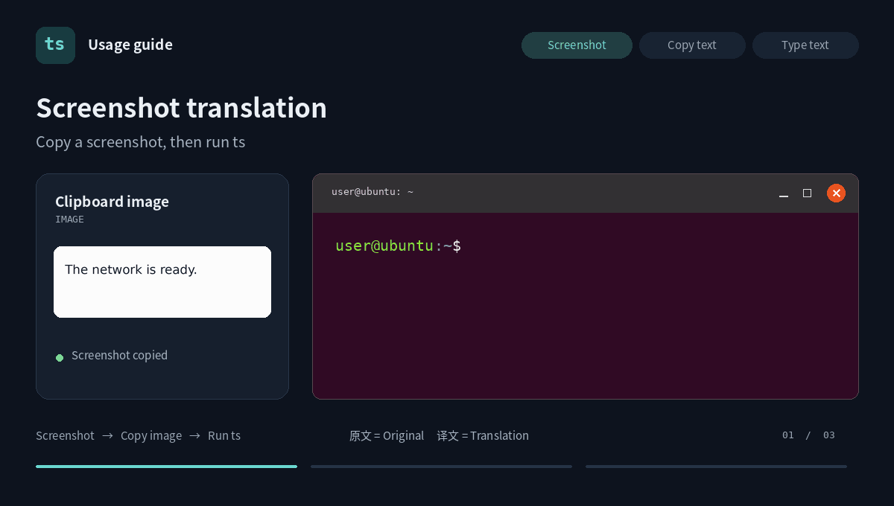

([简体中文](README_zh.md) | English)

# **T**ran**s**lator

An offline Chinese-English terminal translator for Linux. Copy text or an image, then run `ts` to translate the clipboard.



## Use

Copy text or an image, then run:

```bash
ts
```

You can also enter text directly:

```bash
ts 'Hello world.'
```

## Install

Installation requires a network connection. After setup, translation runs offline.

```bash
git clone https://github.com/5ooo/translator.git
cd translator
./install.sh
```

Installation may ask for an administrator password. See the [usage guide](docs/USAGE.md) and [installation guide](docs/INSTALLATION.md) for details. The source code is available under the [MIT license](LICENSE).
