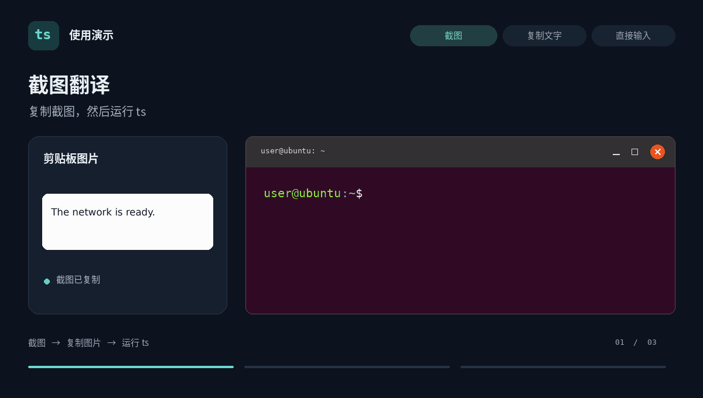

([English](README.md) | 简体中文)

# **T**ran**s**lator

ts 是一个 Linux 离线终端中英翻译工具。复制文字或图片后运行 `ts`，即可翻译剪贴板内容。



## 使用

复制文字或图片，然后运行：

```bash
ts
```

也可以直接输入文字：

```bash
ts 'Hello world.'
```

## 安装

安装时需要联网，安装完成后可离线翻译。

```bash
git clone https://github.com/5ooo/translator.git
cd translator
./install.sh
```

使用 Docker 常驻服务可加快后续图片识别和翻译。请先安装并启动 Docker，然后运行 `./install.sh --docker`。

安装时可能需要输入管理员密码。更多用法和环境要求见[使用说明](docs/USAGE.md)和[安装说明](docs/INSTALLATION.md)。项目源码采用 [MIT 许可证](LICENSE)。
