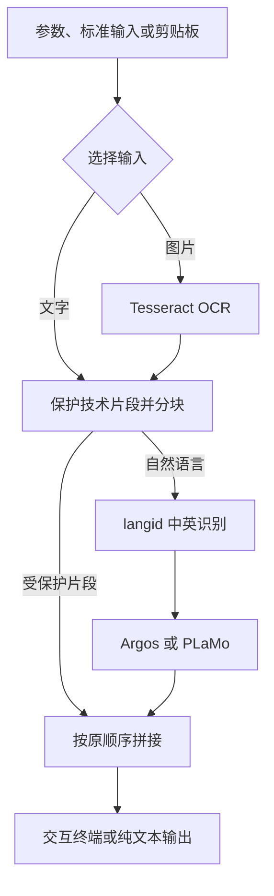

# 架构设计

## 处理流程

`InputResult` 记录文字来自普通输入还是图片。图片只执行一次 OCR，原文显示和翻译共用识别结果。

## 模块

| 模块 | 职责 |
| --- | --- |
| `cli.py` | 解析参数、编排处理、映射错误和退出码 |
| `inputs.py` | 选择输入、访问剪贴板、读取图片并调用 OCR |
| `text.py` | 保护技术片段、分块并编排识别和翻译 |
| `engine.py` | 本地 langid、Argos 模型与 CTranslate2 推理 |
| `models.py`、`model_picker.py` | 模型注册、可用性检查、配置和交互选择 |
| `plamo.py` | PLaMo 模型及本地运行器的生命周期和推理 |
| `events.py`、`presentation.py` | 处理阶段事件、终端排版和纯文本输出 |

`text.py` 按原文顺序复制受保护片段，并对间隙中的自然语言调用识别与翻译。标识符和路径的识别基于规则，有歧义时可用反引号明确边界。分块和功能约束见[需求与功能边界](REQUIREMENTS.md)。

## 模型与离线边界

语言识别和模型按需加载，单次命令复用已加载的方向模型；进程退出后不保留模型在内存中。Argos 使用本地包的 tokenizer 和 CTranslate2 推理，绕过可能补充在线资源的高层分句接口。

PLaMo 按需启动项目内或指定的 `llama-server`，仅使用本机回环连接，并通过 `/proc` 验证连接属于该子进程。输入或输出无效、结果被截断、运行器错误时程序报错；结束或中断时关闭子进程。自动设备模式先尝试已安装的 Vulkan 运行器，失败后尝试 CPU。

模型和依赖由安装阶段获取，翻译期间不访问外部服务。启动器优先使用项目内运行文件，相关环境变量可覆盖路径；详细位置和打包条件见[安装与配置](INSTALLATION.md)。

## 显示与验证

`Presenter` 根据 stdout、`TERM`、`NO_COLOR` 和 `--plain` 选择排版；状态动画还要求 stderr 是终端。输入与模型通过阶段回调报告真实步骤，不按时间推算进度。显示细节见[终端显示](TERMINAL_DESIGN.md)，测试方法见[实现与验证](IMPLEMENTATION.md)。
