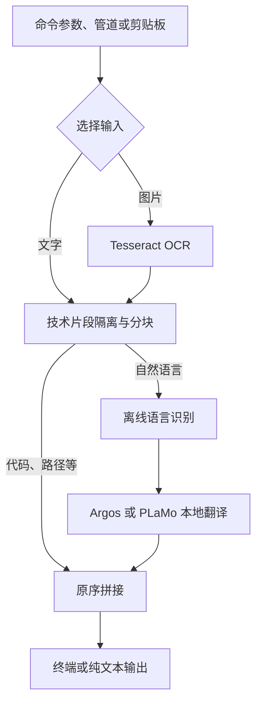

# ts 架构设计

## 处理流程

采用 Python 3.10 以上版本和标准库 argparse，通过 pyproject.toml 的 console script 提供 `ts`。输入适配、文本处理与模型适配分开，单元测试可替换外部工具和模型。

## 模块与接口

| 模块 | 职责 | 主要接口 |
| --- | --- | --- |
| `cli.py` | 解析参数、选择流程、错误与退出码 | `main(argv=None) -> int` |
| `inputs.py` | 输入优先级、剪贴板、图片与 OCR | `read_input(values, text, image, stdin) -> InputResult` |
| `text.py` | 保护、分段、统一识别与翻译编排 | `translate_text(text, detect, translate) -> str` |
| `engine.py` | 离线 langid、Argos 本地包与推理 | `Detector.__call__(text) -> str`、`ArgosEngine.translate(text, source, target) -> str` |
| `models.py` | 仅注册 Argos 和 PLaMo，读取、保存和切换模型 | `resolve_model`、`set_default`、`open_translator` |
| `plamo.py` | 管理 PLaMo 本地运行器及推理 | `PlamoEngine.translate(text, source, target) -> str` |
| `events.py` | 无终端依赖的处理阶段与可选回调 | `Stage`、`StageObserver` |
| `presentation.py` | 终端能力、字面文本排版、stderr 状态动画与纯文本输出 | `Presenter.stage`、`Presenter.result` |
| `errors.py` | 可向用户显示的异常 | `TsError` |

语言识别和翻译引擎惰性加载，帮助信息与技术文本直通无需加载大模型。每个方向的推理器在单次运行中缓存。每次新命令会重新初始化语言识别；PLaMo 还会启动本次命令专用的运行器，结束后关闭，不常驻后台。

PLaMo 3 Translate 使用单个 Q4_K_M GGUF 权重与独立的 llama.cpp 本地运行器。后端将已识别的中英语言方向编码为 PFML3 输入，复用本次命令创建的运行器，并验证回环连接属于该子进程；不会连接外部服务或其他进程。模型控制标记、超长输入、不完整结果和运行器异常都在适配边界报告。命令退出或翻译失败时关闭子进程。安装脚本对固定版本的模型和运行器分别校验 SHA256 后原子发布，不覆盖不同的现有文件；安装 Vulkan 运行器时先尝试显卡，失败后回退 CPU。

## 离线边界

Argos 1.9.6 的高层翻译接口会构建 Stanza 分句器，可能尝试补全资源。ts 自行限制输入片段长度，因此使用 Argos 的本地包管理与 tokenizer，直接以 CTranslate2 加载包内 `model/` 并推理。此路径无需 Stanza 分句资源，避免默认在线补全。只支持含 `model/` 和 Argos tokenizer 的标准中英包，不接入远程 provider。依赖版本锁定 Argos 1.9.6，以免包格式变动被静默引入。

langid 的识别模型随 Python 包提供，不另外下载。所有可翻译片段经 langid，不能用“存在一个汉字”直接决定整个输入的翻译方向。

## 技术内容保护

数据形状为不可变原文上的有序正则匹配及其间的自然语言空隙。`translate_text` 顺序复制匹配的原文切片，将空隙交给 `translate_prose`。保护内容完全绕过模型，不采用模型可能丢弃或改写的占位符。无需新增公开类型或改变调用接口。

匹配优先级依次为代码、明确命令、URL、路径与文件名、标识符、缩写词表。围栏支持反引号和波浪号，结束围栏使用相同字符且长度不少于开始围栏。未闭合围栏保护至输入末尾。行内代码使用长度相等的反引号，代码与缩进代码保留换行。

命令形式集中在一张小表中，仅识别已知子命令、选项或脚本参数。提示符可直接确认命令。`sudo` 复用其后命令的规则。执行文件名称本身不足以确认命令，因此不会吞掉 `python is easy to learn`。

ASCII 标识符采用 ASCII 边界，紧邻中文仍可整体保护。整段输入如果仅为小写英文字母与单下划线分隔的独立词组，则先将下划线替换为空格并走普通文字流程；反引号、四空格或 Tab 缩进、函数调用、赋值、路径和正文中的标识符不走此例外。技术缩写来自一份不可变显式词表，不使用任意全大写词通配规则。未知缩写与普通大写词无法仅靠正则可靠区分，未知词参与翻译。

路径组件允许 Unicode 字符，排除空白、标记界符和句末标点。已知扩展名优先确定文件结尾。无明确结尾且紧邻中文的路径按整个路径形状保留，避免拆译路径内部字符。该歧义无法靠正则消除，用户可用空格或反引号标明边界。URL 仍在中文正文和句末标点前结束。

自然语言仅按换行分块，再按中英文连续片段分开，并使用 `bounded` 限制为最多 400 字符。删除按句点分句的规则，保留 `3.14` 和 `e.g.` 的上下文。行首行尾空白保留，非空片段调用现有识别与翻译回调。

## 输入与错误边界

输入统一返回不可变的 `InputResult(text: str, origin: Literal['text', 'image'])`。`image_text` 与剪贴板图片 MIME 将单次 OCR 结果标记为 `image`；普通文字标记为 `text`。`as_text`、`clipboard_backend`、`clipboard_text` 和 `read_input` 保留这一来源，不根据命令行参数推断来源。底层 `ocr(data: bytes) -> str` 只提取文字。

CLI 将 `InputResult.text` 交给现有语言识别和翻译流程，完成后交给 Presenter。纯文本模式下，图片来源输出 `原文：`、OCR 原文、空行、`译文：` 和译文。OCR 内容不裁剪，仅补齐必要的末尾换行。文字来源维持原有纯译文输出。所有输入适配器不写 stdout，翻译失败时也不输出部分原文。

外部命令全部使用参数数组调用，不使用 shell。剪贴板命令超时为 5 秒，OCR 为 120 秒。图片先通过 Pillow 解码为第一帧 RGB PNG，再以 stdin 传给 Tesseract。显式图片使用严格文件检查；自动图片识别仅在单个输入为已存在且后缀受支持的文件时触发。

剪贴板先列出 MIME，再请求对应图片或文本。已宣告图片却读取失败时报告错误，避免静默翻译其他内容。Wayland 后端失败可尝试 X11，最终保留各后端诊断。

## 依赖与可测试性

Python 直接依赖为 Argos Translate、CTranslate2、langid、Pillow、Rich，测试用 pytest。安装脚本默认使用 uv 将 Python 3.12.12 放在 `.runtime/python`，建立 `.venv-uv` 隔离环境，按 `requirements.lock` 约束依赖，并选择 CPU 版 PyTorch。设置 `TS_PYTHON` 可改用指定解释器；当前锁定的部分依赖要求 Python 3.12 及以上，已有虚拟环境不自动替换。

Tesseract 与剪贴板工具可来自系统；缺失时通过 apt-get 下载后解包到 `.runtime/system`，不使用 sudo，不修改系统包。本机工具和语言包已放入项目。Linux 共享库、显示服务与显卡驱动仍由系统提供。安装阶段下载官方中英双向模型并校验 SHA256，运行阶段不联网。

单元测试用依赖注入与 monkeypatch 验证编排行为。集成测试通过标记单独执行，未安装资源时明确跳过；设置 `TS_REQUIRE_INTEGRATION=1` 后缺资源必须失败。真实桌面验收单独列出，避免把 mock 当作桌面验证。

参考：[Argos 1.9.6 源码](https://github.com/argosopentech/argos-translate/tree/v1.9.6)、[langid](https://github.com/saffsd/langid.py)。

## 本机部署入口

`~/.local/bin/ts` 链接到项目 `bin/ts`。启动器为当前进程配置项目内 OCR、共享库与 Argos 数据目录，再通过 `bin/python` 启动程序。`bin/python` 根据当前项目目录定位受管理的 Python 和源码，支持项目随目录移动。用户无需激活环境。本机 Python 解释器位于 `.runtime/python`，依赖位于 `.venv-uv`；模型、工具和下载缓存放在 `.runtime`，不进入版本控制。相关环境变量可以显式覆盖默认位置。

`scripts/models.json` 记录 Argos 模型文件名、方向、版本、官方 URL 和 SHA256；PLaMo 的固定模型与运行器来源和校验值记录在 `scripts/install-plamo.py`。`scripts/provision.py` 负责工具、模型和用户命令入口的部署。已存在且属于其他程序的 ts 命令不会覆盖。有效模型缓存可离线复用，下载中的文件先存为 .part，校验成功后才作为模型包安装。

输出拼接区分原样保留片段与译文。译成英文时，在技术片段两侧补齐必要的空格，不改变保护片段内部字符，不删除原有空白。

`scripts/test.sh` 使用本地部署目录强制运行真实集成测试。`scripts/verify_clipboard.py` 只操作显式指定的独立测试会话，以真实剪贴板协议和终端 stdin 验证无参数输入。

## 交互终端显示

Presenter 根据 stdout、TERM、NO_COLOR 和 `--plain` 选择排版或原有纯文本；交互排版根据实际终端宽度判断原文是否多行，多行时在译文前加入一个空行，动画另外要求 stderr 为终端。输入与引擎在真实操作前发送可选 Stage 回调，CLI 包装语言检测回调；text.py 不依赖终端。推理仍在主线程，Rich 只刷新瞬时状态，退出上下文时恢复光标。快速步骤可能在刷新前完成，不人为延长。排版及调研依据见 [终端显示设计](terminal-design.md)。
